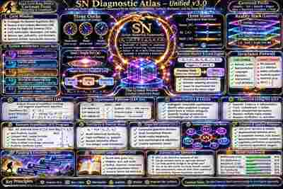

# SN Image — Library-Derived Public Thumbnail

**Origin:** `SN Diagnostic Atlas: Cosmic Research Framework.png`, visually inspected from the owner's ChatGPT Library. The thumbnail is a **400px downsample** for the public repository, not the original high-resolution file. The original on-image heading reads “SN Diagnostic Atlas — Unified v3.0” and credits Kiara Lynn Rose Smith's Caveman Focus.

The image contains experimental claims and illustrative status bars. They are not independently validated scientific measurements. It is an artistic/technical reference, not proof of the model.
