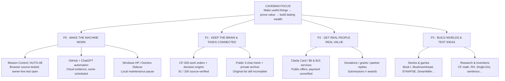

# Caveman Focus — The Jungle Map

> **DATED SNAPSHOT — NOT LIVE.** This map was compiled November 10, 2026 from a particular public source revision. **If you're reading it later, its counts, deadlines, and statuses may be old.** Open the [**Current Source Gateway**](CURRENT_SOURCE_GATEWAY.md) (moving `main` link) or [Mission Control](https://whoiwts110217-creator.github.io/CF-0/mission-control/) for a fresh GitHub registry read. Every project, idea, game, experiment, grant, archived source and task follows [CF-FRESH-001](UNIVERSAL_FRESHNESS_CONTRACT.md). Source-link freshness does not prove HP/account/payment activity.

### Owner's field guide · source snapshot: November 10, 2026, Eastern

**Start here when the whole system feels scattered.** This is a public-safe *navigation and attention map*, not a new 200-task registry, a live account controller, a private transcript export, or permission to activate anything. The [authoritative CF-200 registry](../automation_200/registry.json), [current source status](PUBLIC_CONTINUITY_STATE.json), and [mission board](../automation_200/MASTER_MISSION_BOARD.md) outrank any stale number here. Source observed at public `main` commit `ac1c1dd1a8cae4a0b5060b6909422bf63a83187f`.

## 1. View from above

**Priority is directional, not exclusivity.** P0 reliable automation → P1 owner-governed choices/continuity → P2 legitimate verified income → P3 creative and research, with P3 preserved and moving when an authorized, unblocked task permits. The November 13 grant deadline is a parallel time-sensitive P2 obligation.

## 2. Where we really stand

| System | Source-supported state | Still missing / don't assume |
|---|---|---|
| **CF-200** | **91 / 200 verified work orders; 109 planned**; registry and append-only ledger match | 91 tasks is **not** 91 completed projects, an HP deployment, or company revenue |
| **Mission Control** | [One public command dashboard](https://whoiwts110217-creator.github.io/CF-0/mission-control/), with published inventory and limited UI | A connected *universal* cross-provider master switch |
| **AUTO-08 Chrome** | [v0.1.6](../automation_200/continuation_chrome/README.md), keyboard-first single-tab `continue` source with STOP/recovery tests; [later queued-STOP fix passed CI](https://github.com/whoiwts110217-creator/CF-0/pull/97) | One real, owner-selected signed-in Chrome conversation successfully sent/finished/STOP-resumed; iPhone cannot install unpacked desktop Chrome extension |
| **Windows HP relay** | Public read-only relay and digest-matched ping evidence; three known local tasks documented | **[Owner maintenance pause](https://github.com/whoiwts110217-creator/CF-0/issues/95): FastLane, Relay, Supervisor disabled.** Do not restart without owner-local review. Scheduler→specific receipt origin and weeklong autonomy unverified |
| **Domino Sidecar** | Recovered logic, hash checks, source/Windows tests; enabled ChatGPT refinement task | Present, correct, unattended owner-HP installation and actual durable sidecar execution |
| **Cloud automations** | **5 enabled ChatGPT tasks** at Nov 10 check; **26 GitHub Actions workflow definitions**, not necessarily 26 active jobs | Automatic unified management of all the owner's apps, both ChatGPT accounts, HP and iPhone |
| **Continuity / archive** | Public three-chat bootstrap, topic map, source labels; private recovered-material backups and a 62-entry *reconstruction* | Original approximately 37-project list, complete original chat exports and verified automatic cross-account recovery |
| **Money / funding** | Free clarity product, $5/$15 inquiry pilots, donation pages, grant applications, reply watches | Independently verified customer payment, donation settlement, paid service delivery or grant award **not established** by the inspected evidence |

**Actual configured ChatGPT tasks enabled at this check:** CF-200 Four-Task Executor, Bridge Builders Reply Watch, Hacker Initiative Grant Watch, Caveman Focus archive recovery, and Refine Domino Sidecar. Six other recorded task entries are *not enabled* (some paused, some completed). A scheduled task's existence never proves its most recent result succeeded. Existing GitHub Actions source currently contains 26 workflow definitions (reported inventory: six scheduled, twenty event/manual); local Windows tasks are a separate surface.

## 3. Trailheads: what belongs where

### P0 — Operations / the machine
- **Single control surface:** Mission Control. Keep honest connected / source-only / disconnected labels.
- **AUTO-08:** one existing Windows Chrome tab, correct manually verified login, exact `continue`, completed-response receipts, STOP, no duplicates. Optional submission-only fast mode is *not* a completed reply.
- **HP bridge and scheduler:** reliable request → permitted local action → digest-matched receipt → report. Currently paused for local maintenance. Historical Notepad launches do not mean the present public relay can launch it.
- **Domino Sidecar, agent/skill tools, monitoring:** original source/tests and status. Source packages are not installed ChatGPT plugins, machine authority, or guaranteed agent autonomy.
- **Current technical cloud work:** watchdog→CF-200 source packet correlation; investigate intermittent GitHub HTTP 403; preserve browser cancellation/source tests. Do not automatically restart HP.

### P1 — The brain, memory and decision machinery
- [CF-200 registry](../automation_200/registry.json) → [priority selector](../automation_200/priority_selector.py) → [public handoff](../automation_200/MASTER_MISSION_BOARD.md) → [one-link three-chat bootstrap](mesh/START_HERE.md).
- [Master Operator](../automation_200/MASTER_OPERATOR_PROMPT.md), [Master Continuity](../automation_200/MASTER_CONTINUITY_PROMPT.md), and [Work prompt](../automation_200/WORK_COPY_PASTE_AUTOMATION_PROMPT.md) are consulted **in that order**, never replaced by this map.
- [UCC-001](UNIVERSAL_CONTINUITY_CONTRACT.md) keeps projects' parent links, source, status, contradictions, rollback, next action and privacy. [Truth reconstruction](SOURCE_TRUTH_RECONSTRUCTION_PROTOCOL.md) keeps original words/math distinct from summaries.
- Archive recovery is ongoing; **17 named older rows, disputed older 18-row summary, missing original ~37 list, and later private 62-entry mixed atlas are different records.** No claim of full recovery.
- **Future owner checklist:** one personal view derived from these real sources, labeling `Needs You` / `AI Handling` / `Blocked` / `Done`. It has **not** been deployed as an always-on account-level monitor; don't create a second competing registry.

### P2 — Real-world value, outreach and money
- **Working/public:** [free Clarity Card](https://whoiwts110217-creator.github.io/CF-0/clarity-card/), [$5 Clarity Check](https://whoiwts110217-creator.github.io/CF-0/clarity-check/), [$15 Clarity Brief](https://whoiwts110217-creator.github.io/CF-0/clarity-brief/) and [voluntary support](https://whoiwts110217-creator.github.io/CF-0/first-drop/). The paid services are **inquiry pilots**, not verified checkout or paid fulfillment.
- **Hacker Initiative Grant 2026:** application reported/confirmed submitted Nov 9; enabled watch for a real response; **no grant award or payment verified**.
- **Port Huron Bridge Builders, $1,500:** owner-reported November 9 submission; **official receipt remains unverified**. Deadline **Friday, November 13, 2026**; eligibility/category was ambiguous. Keep the existing reply watch, don't assume failure or send a duplicate application; preserve accurate owner declarations.
- **Donation growth, AI Tracker/Hall of Fame, community channels, microservices:** public leads and prepared source exist; outbound contacts, customer demand, outside agent participation and payments require their own real receipts. Paused cash pilot and research/grant-search tasks must not be described as running.
- **Winning evidence:** one real customer accepts scope, delivery is done, and payment is verified—or an actual grant award/payment. A link, PR, application or donation goal is not cash.

### P3 — Don't lose the inventions, the stories or the games

**Creative:** *Single-Dot Universe Book I* (separate from the research system), *Mushroomhead / Blue Water County / Poho*, *SYNAPSE / Kyōji*, *BROKEN LOGIC*, the grandfather sunset/Elias Vale works, the Book Machine, Breach Dungeon Android history, Dreamkiller/BreachDungeon Game Boy concept and tested prototype, and gameful learning / Brainrot → Brainpower.

**Science and philosophy:** Caveman Focus original math/operators (incomplete), Riemann Hypothesis (not proved), Single-Dot research, Syntactic Mechanics, shifted arithmetic, FORM 8.2, inverse reconstruction/mixed paint, Automatogenesis, Reality Compiler/Affordance Forge, Philosopher's Stone/magician threshold, AI sentience and consciousness, speculative cosmology, and the Friday Research Brief (last recorded as not enabled).

**Status rule:** ideas and drafts remain valuable without being labeled products, established theories, validated device builds, proof or completed work. Original manuscripts/private source stay in the owner's private collection unless separately approved for publication. The [public project index](PROJECTS.md) and [research overview](RESEARCH.md) are the source navigation pages.

## 4. The one-page owner-action radar

| Priority | Who carries it | What happens next | Owner gate |
|---|---|---|---|
| **Time-sensitive: Bridge Builders by Nov 13** | Existing reply watch checks inbound messages | Resolve external receipt/eligibility only if evidence arrives; don't duplicate the owner-reported submission | **Only if available/asked:** retain the official submission confirmation/reference privately, or answer a genuine funder request |
| **P0: Windows HP recovery** | Cloud work continues; local restart on hold | Preserve maintenance snapshot, make a safe disk/backup/reinstall decision **before** re-enabling tasks | **Owner-local step later; not authorized or required right now** |
| **P0: AUTO-08 one-chat acceptance** | Code/test workflow and source diagnosis can continue | When the HP/account is ready, open one low-stakes chat and perform no-send readiness → one live run → inspect STOP | **Owner signs in and selects account; no password shared with AI** |
| **P1: Truth and routing** | CF-200 executor, public map, archive recovery | Re-read current registry, link projects, spot clashes/missing sources; continue safe source work | No routine owner copy/paste |
| **P2: First verified $** | Published offers + inbound reply monitoring | Capture a real inquiry, make scoped deliverable, then reconcile real payment separately | Owner approves any real pricing/checkout or banking action before it occurs |
| **P3: Creative/research** | Separate project branches | Preserve drafts, test ideas, maintain honest proof/status gates | New priorities and publication decisions only when consequential |

**What this means today:** There is no reason to send the owner 109 raw remaining tasks. The owner should see **one concrete needed action at a time**. The closest dated decision is Bridge Builders confirmation before November 13; HP maintenance and Chrome sign-in remain later owner-local gates. Cloud/source work and current watches can continue independently.

## 5. Navigation and guardrails

- [Today / current tasks and issues](TASKS_AND_ISSUES.md) · [All 200 authoritative work orders](../automation_200/registry.json) · [Public mission log](../automation_200/MASTER_MISSION_BOARD.md)
- [Project index](PROJECTS.md) · [Single-link three-chat continuity](mesh/START_HERE.md) · [Source-truth protocol](SOURCE_TRUTH_RECONSTRUCTION_PROTOCOL.md)
- [Mission Control](https://whoiwts110217-creator.github.io/CF-0/mission-control/) · [AUTO-08 source](../automation_200/continuation_chrome/README.md) · [HP maintenance evidence](https://github.com/whoiwts110217-creator/CF-0/issues/95)
- [Owner-action handoff contract](OWNER_ACTION_HANDOFF_PROTOCOL.md) · [Approval bin](../automation_200/PROMPT_CHANGE_BIN.md) · [Finance status](PUBLIC_CONTINUITY_STATE.json)

**Scope / rollback:** Public-safe operational map only. It does not initiate a schedule, install software, re-enable HP jobs, alter owner permissions, sign into accounts, submit an application, contact a customer, publish private archives or change CF-200 evidence. Edit or revert this one document and its optional index pointer if evidence changes. Re-fetch authoritative sources before making decisions; the snapshot is not an always-current widget.
